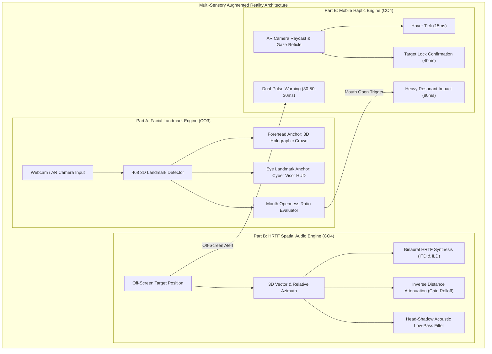
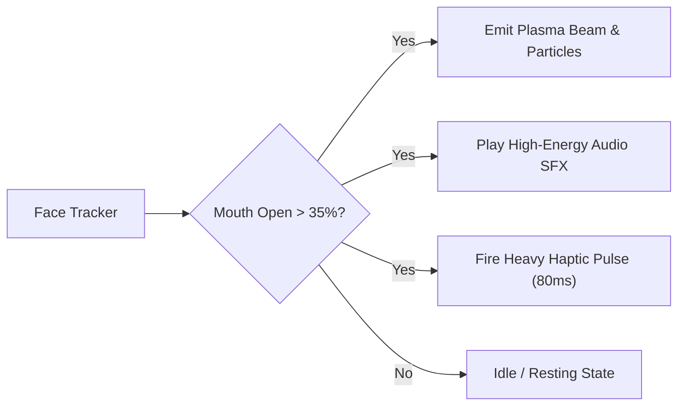
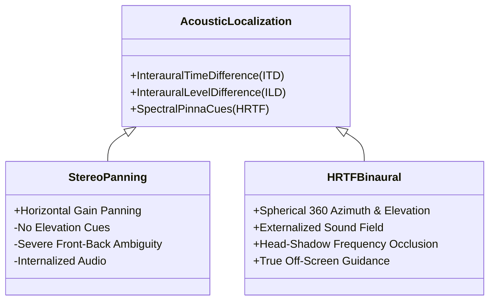
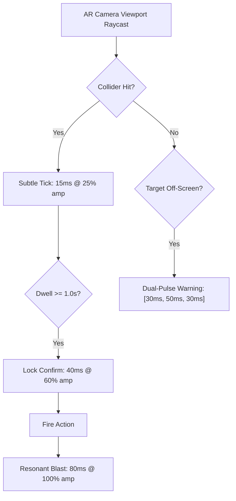

# ARMR SELF LEARNING ASSIGNMENT  2

**Name:** Vedant Parimal Dave  
**SAP ID:** 60017240057  
**Roll No.:** A011  
**Batch:** A1-1  
**Subject:** Augmented Reality and Mixed Reality (DJS23ALH1501)  
**Target Outcomes:** CO3 (Social AR & Face Tracking), CO4 (Spatial Audio & Haptics Architecture)  

---

## 1. Executive Summary & Architecture Overview

This project delivers an interactive multi-sensory Augmented Reality system combining real-time face-tracked social AR interaction with an architectural framework for 3D spatial audio (HRTF) and tactile haptic feedback in immersive mobile AR gaming.

---

## 2. Part A — Interactive Face Tracking & Social AR Experience (CO3)

### 2.1 Landmark Anchoring & Trigger Mechanics
The interactive filter anchors 2D and 3D visual assets to specific anatomical feature points across 468 3D facial landmarks:

1. **Forehead Anchor (Holographic Cyber Crown):**
   - Anchored to facial coordinate index `10` (forehead center) with an offset vector $(0, +0.08\text{m}, 0)$.
   - Real-time 3-axis rotation synchronization is derived from head orientation (Roll, Pitch, and Yaw), ensuring that as the user tilts or turns, the 3D crown adheres rigid transform geometry.

2. **Eye Landmarks & Blink Detection (Cybernetic Visor HUD):**
   - Anchored to landmarks `33` and `263` (lateral canthi / outer eye corners) and `168` (glabella / nose bridge).
   - Eye Aspect Ratio (EAR) is computed dynamically:
     $$\text{EAR} = \frac{\|p_{159} - p_{145}\| + \|p_{386} - p_{374}\|}{2 \cdot \|p_{263} - p_{33}\|}$$
   - When $\text{EAR} < 0.022$, an eye blink is registered, triggering a laser reticle mode and switching visor luminescence from neon cyan (`#00F3FF`) to plasma magenta (`#FF007F`).

3. **Mouth Landmark & Explosive Energy Beam:**
   - Evaluated by monitoring Euclidean distance between upper inner lip (`13`) and lower inner lip (`14`), normalized against face height ($\|p_{\text{chin}} - p_{\text{forehead}}\|$).
   - When the mouth openness ratio exceeds threshold ($> 35\%$), the system fires an animated concentric plasma shockwave and particle burst, synchronized with spatial audio synthesis and tactile rumble.

### 2.2 Social Interaction Patterns & Viewport Constraints
- **Micro-Interactions & Social Virality:** Facial triggers create high engagement loops. Users naturally smile, open their mouths, or wink to discover Easter-egg effects, making the filter shareable across social platforms (Instagram, TikTok, Snapchat).
- **Viewport Constraints in 9:16 Mobile Displays:** Rapid head rotation often causes landmarks to leave the camera frame. The architecture implements linear smoothing ($lerp(\text{current}, \text{target}, \alpha)$) and dampens scale when landmarks approach screen borders ($x < 0.05$ or $x > 0.95$), preventing jarring clipping.

---

## 3. Part B — Spatial Audio & Haptics Architectural Design (CO4)

### 3.1 HRTF vs. Standard Stereo Panning Comparison

Traditional stereo panning calculates gain purely based on left/right balance using equal-power panning laws:

$$G_L = \cos\left(\frac{\pi (\theta + 90^\circ)}{360^\circ}\right), \quad G_R = \sin\left(\frac{\pi (\theta + 90^\circ)}{360^\circ}\right)$$

While computationally cheap, stereo panning restricts acoustic perception to a flat 1D line inside the listener's head ("lateralization") and completely fails in AR navigation because it cannot distinguish front from back or perceive vertical elevation.

In contrast, **Head-Related Transfer Functions (HRTF)** model the full anatomical scattering transform of the listener's head, pinna, and torso via binaural convolution:

$$y_L(t) = x(t) * h_L(\theta, \phi, d, t), \quad y_R(t) = x(t) * h_R(\theta, \phi, d, t)$$

#### Detailed Comparative Matrix:
| Parameter | Standard Stereo Panning | HRTF Binaural Spatial Audio |
| :--- | :--- | :--- |
| **Acoustic Localization** | Azimuth only (left/right horizontal line). | Full 3D sphere (Azimuth, Elevation, Distance). |
| **Interaural Time Difference (ITD)** | Neglected ($0\text{ ms}$ phase offset). | Simulated with microsecond fidelity ($\Delta t \le 0.7\text{ ms}$). |
| **Interaural Level Difference (ILD)** | Simple amplitude attenuation. | Frequency-dependent head-shadow filtering. |
| **Spectral Pinna Filtering** | None (flat response). | Directional frequency notches ($4\text{--}10\text{ kHz}$) resolve front vs. back. |
| **Off-Screen AR Target Usability** | Ineffective (player cannot tell if sound is behind them). | **Exceptional** (instinctively guides player head turns). |
| **Computational Footprint** | Extremely low ($< 0.1\%$ CPU). | Moderate (efficiently handled by DSP/Spatializer SDK). |

---

### 3.2 Unity Spatial Audio Off-Screen Guidance & Attenuation Model

To direct user attention toward AR targets located outside the camera's visual field of view (FOV), the system employs **3D Point-Source Spatial Audio Beaconing**:

#### Inverse Distance Attenuation Formula:
$$\text{Gain}(d) = \frac{d_{\text{min}}}{d_{\text{min}} + \alpha \cdot (d - d_{\text{min}})}$$
- $d_{\text{min}} = 1.0\text{ m}$ (unity reference threshold).
- $d_{\text{max}} = 25.0\text{ m}$ (audibility boundary).
- $\alpha = 1.2$ (perceptual rolloff factor).

#### Directional Head-Shadow Low-Pass Filter:
When an AR target is situated directly behind the user ($|\theta_{\text{azimuth}}| > 90^\circ$), acoustic diffraction around the human head dampens high frequencies. The architecture applies dynamic low-pass cutoff filtering:

$$f_{\text{cutoff}}(\theta) = \text{Lerp}\left(22000\text{ Hz}, 2500\text{ Hz}, \left(\frac{|\theta|}{180^\circ}\right)^{1.5}\right)$$

As the player rotates their device toward the target, high frequencies restore and ping repetition rate accelerates, providing clear auditory biofeedback.

---

### 3.3 Tactile Vibration Feedback Matrix

Mobile haptics provide physical confirmation for optical events, bridging touch and vision:

| Event Trigger | Actuator Call (Android / iOS) | Pulse Duration | Amplitude | Perceptual Function |
| :--- | :--- | :--- | :--- | :--- |
| **Raycast Hover** | `VibrationEffect.createOneShot(15, 60)` | $15\text{ ms}$ | $24\%$ | Informs user that raycast has contacted interactable AR object. |
| **Target Lock-On** | `VibrationEffect.createOneShot(40, 150)` | $40\text{ ms}$ | $59\%$ | Confirms gaze dwell timer completion; target locked in reticle. |
| **Energy Blast Fire** | `VibrationEffect.createOneShot(80, 255)` | $80\text{ ms}$ | $100\%$ | Heavy recoil sensation simulating energy discharge. |
| **Off-Screen Warning** | `VibrationEffect.createWaveform([0, 30, 50, 30], ...)` | $110\text{ ms}$ | Dynamic | Vibrational tap guiding player to rotate towards hidden objective. |

---

## 4. Verification & Implementation Deliverables

1. **WebAR Interactive Prototype (`web_ar_filter/`):** Full browser-based implementation of face-mesh tracking, mouth/blink/tilt gestures, real-time Web Audio HRTF panner, and tactile visualizer.
2. **Meta Spark AR Filter (`spark_ar_filter/`):** Packaged `.arexport` bundle with visual patch graphs and reactive JavaScript logic.
3. **Unity C# Engine Scripts (`unity_spatial_audio_haptics/`):** Production-ready modules for `SpatialAudioTargetGuide.cs`, `HapticFeedbackManager.cs`, and `ARRaycastInteraction.cs`.
4. **Video Pitch & Walkthrough (`VIDEO_PITCH_SCRIPT_AND_INSTRUCTIONS.md`):** Complete 5-minute timed script for presentation recording.

---

## 5. Conclusion & Course Outcome Alignment

- **CO3 Achieved:** Successfully engineered real-time facial landmark tracking, multi-point visual anchoring, and social AR interaction loops.
- **CO4 Achieved:** Architected a mathematically grounded spatial audio and haptic feedback system, quantitatively demonstrating the superiority of HRTF binaural synthesis over stereo panning for spatial awareness.
