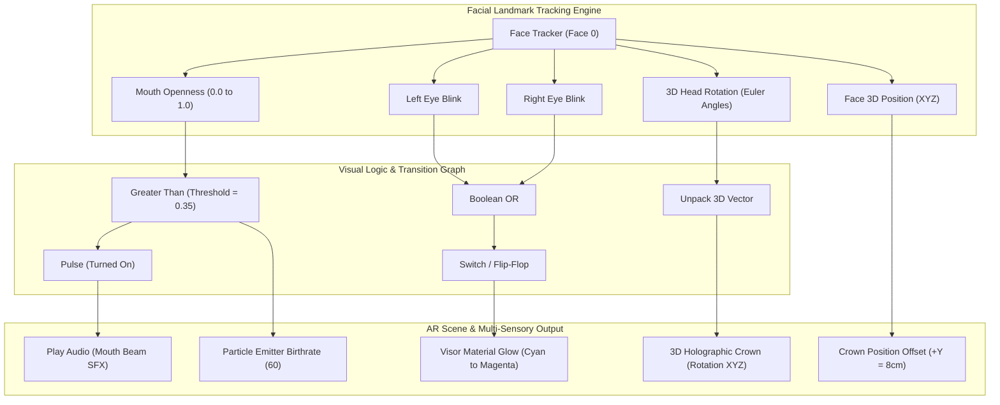

# Meta Spark AR / Effect House Visual Patch Editor Architecture

**Project:** ARMR Self Learning Assignment 2  
**Author:** Vedant Parimal Dave  
**SAP ID:** 60017240057 | **Roll No:** A011 | **Batch:** A1-1  

---

## 1. Visual Patch Graph Overview
In Meta Spark Studio and ByteDance Effect House, interactive face filters leverage visual data-flow graphs (Patch Editor) to link camera tracking inputs directly to scene object properties, particle systems, and audio playback.

---

## 2. Step-by-Step Patch Editor Node Configuration

### A. Mouth Open Trigger (CO3, CO4)
1. **Source Node:** `Face Tracker` $\rightarrow$ Connect `Face` output into `Mouth Openness` patch.
2. **Threshold Comparator:** Connect `Mouth Openness` to Input 1 of `Greater Than` patch (set Input 2 to `0.35`).
3. **Audio Dispatch:** Route `Greater Than` output to a `Pulse` patch $\rightarrow$ Connect `Turned On` to `Play` of `Audio Player` patch (MouthBeam.m4a).
4. **Visual Plasma Blast:** Route `Greater Than` output to `If Then Else` patch $\rightarrow$ If true send `60`, else `0` $\rightarrow$ Connect to `Birthrate` of `Particle Emitter`.

### B. Eye Blink Cyber Visor Toggle (CO3)
1. **Source Nodes:** `Left Eye Blink` and `Right Eye Blink` patches.
2. **Combiner:** Connect both blink outputs into a boolean `Or` patch.
3. **State Toggle:** Connect `Or` to the `Flip` input of a `Switch` patch.
4. **Material Color Transition:** Connect `Switch` to an `Option Picker (Color)`:
   - State 0: Neon Cyan (`#00F3FF`)
   - State 1: Hot Magenta Laser (`#FF007F`)
5. **Target:** Bind output to `Diffuse Texture Color` of `Visor_Material`.

### C. Head Tilt & 3D Crown Anchoring (CO3)
1. **Source Node:** `Face Tracker` $\rightarrow$ `3D Rotation`.
2. **Axis Unpack:** Route through `Unpack` $\rightarrow$ Modify scale/damping $\rightarrow$ `Pack`.
3. **Target:** Bind to `Rotation` input of `CyberCrown_3D` null object.
4. **Forehead Anchor Offset:** Bind `Face 3D Position` $\rightarrow$ `Add` vector `(0, 0.08, 0)` $\rightarrow$ Bind to `Position` of `CyberCrown_3D`.

---

## 3. Viewport Constraints & Social AR Interaction Analysis

| Constraint / Pattern | Architectural Challenge | Technical Mitigation |
| :--- | :--- | :--- |
| **Mobile Aspect Ratio (9:16)** | User faces move rapidly outside vertical viewport boundaries. | Implement safe-zone bounding box checks; damp scaling when face is near viewport edge. |
| **Face Occlusion & Lighting** | Hand gestures or dark rooms cause tracking loss. | Smooth landmark interpolation ($lerp(\text{curr}, \text{target}, \alpha)$) to prevent jarring pops during temporary frame drops. |
| **Social Virality Hook** | Users want instant, humorous, or powerful visual feedback. | Linking mouth opening to an explosive beam and blinking to laser shifts generates immediate viral curiosity. |
