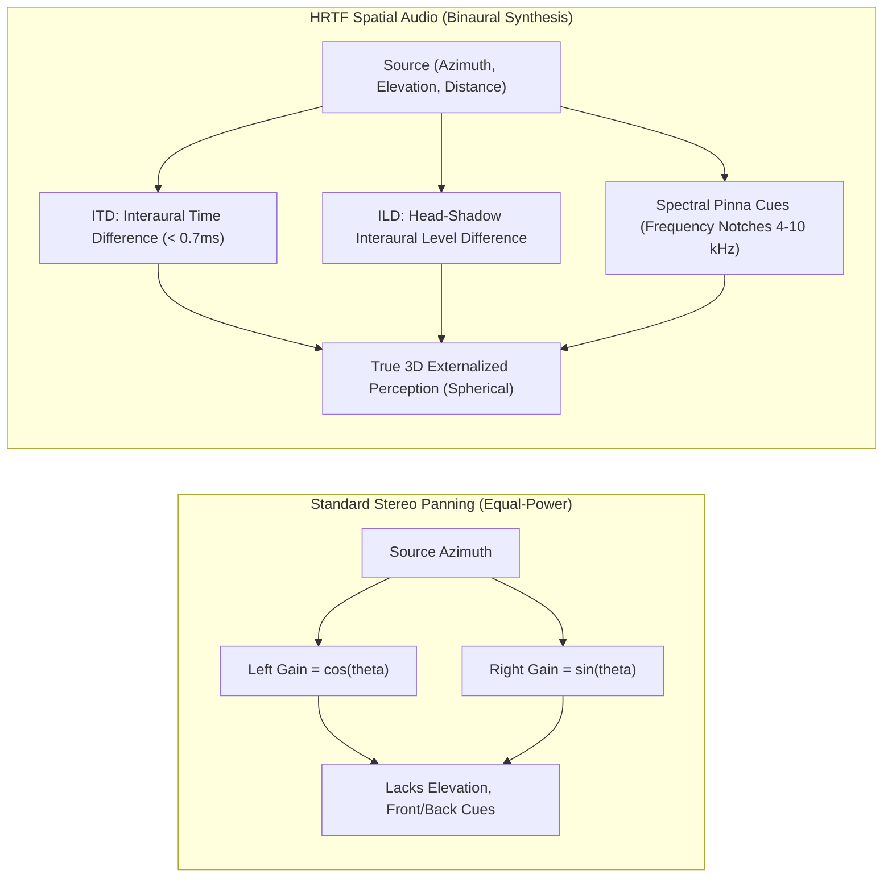

# Spatial Audio Attenuation Models & Haptic Trigger Specifications

**Course:** Augmented Reality and Mixed Reality (DJS23ALH1501) — Assignment 2  
**Author:** Vedant Parimal Dave | **SAP ID:** 60017240057 | **Roll:** A011 | **Batch:** A1-1  

---

## 1. 3D Point-Source Sound Attenuation Models

In Augmented and Mixed Reality environments, distance attenuation governs how perceived sound pressure level (SPL) diminishes as an acoustic point source moves away from the listener.

### A. Inverse Distance Model (Physical Reality)
The standard inverse-square law dictates that acoustic energy decays proportionally to $1/r^2$, resulting in a $6\text{ dB}$ sound pressure drop per doubling of distance:

$$\text{Gain}(d) = \frac{d_{\text{min}}}{d_{\text{min}} + \text{rolloffFactor} \cdot (d - d_{\text{min}})}$$

Where:
- $d_{\text{min}}$ = Reference distance ($1.0\text{ m}$) where gain is unity ($1.0$ or $0\text{ dB}$).
- $d_{\text{max}}$ = Cutoff boundary ($25.0\text{ m}$) where attenuation terminates to avoid infinite computation.
- $\text{rolloffFactor} = 1.2$ (tuned for indoor AR gaming to retain clarity without overwhelming foreground UI).

### B. Unity Curve Comparison

| Attenuation Model | Mathematical Formulation | Best Use Case in AR | Perceptual Characteristic |
| :--- | :--- | :--- | :--- |
| **Logarithmic Rolloff** | $\text{Gain} = \frac{d_{\text{ref}}}{d}$ | Natural acoustic environments (default physical sound). | Smooth, steep initial decay; realistic spatial perception. |
| **Linear Rolloff** | $\text{Gain} = 1 - \frac{d - d_{\text{min}}}{d_{\text{max}} - d_{\text{min}}}$ | UI audio beacons and strict game boundary checks. | Predictable decay; easy for players to estimate distance. |
| **Custom Inverse Curve** | Implemented via `AnimationCurve` | AR Navigation Beacons & Off-screen Targets. | Preserves high-frequency audibility at medium distances ($3\text{--}8\text{m}$). |

---

## 2. HRTF vs. Stereo Panning Spatial Parameter Matrix

---

## 3. Tactile Vibration Feedback Matrix for Mobile AR

| Interaction State | Mobile Event / Trigger | Waveform Signature | Duration | Perceptual Objective |
| :--- | :--- | :--- | :--- | :--- |
| **Raycast Hover** | Reticle enters AR target collider. | Single micro-tick ($A = 60/255$) | $15\text{ ms}$ | Subtle confirmation of target acquisition without distraction. |
| **Gaze Dwell (50%)** | User maintains gaze on target for $0.5\text{s}$. | Rising pulse ($A = 90/255$) | $25\text{ ms}$ | Informs player that selection lock is actively charging. |
| **Target Lock Confirm** | Dwell reaches $1.0\text{s}$ or screen tap. | Solid buzz ($A = 180/255$) | $40\text{ ms}$ | Unambiguous sensory confirmation of action execution. |
| **Mouth Blast / Fire** | Mouth openness exceeds threshold ($> 35\%$). | Heavy resonant thump ($A = 255/255$) | $80\text{ ms}$ | Visceral tactile reinforcement of high-energy interaction. |
| **Off-screen Beacon** | Target is outside camera FOV ($> 60^\circ$). | Dual alert buzz ($30\text{ms}$ on, $50\text{ms}$ off, $30\text{ms}$ on) | $110\text{ ms}$ | Haptic orientation cue to guide head rotation. |
